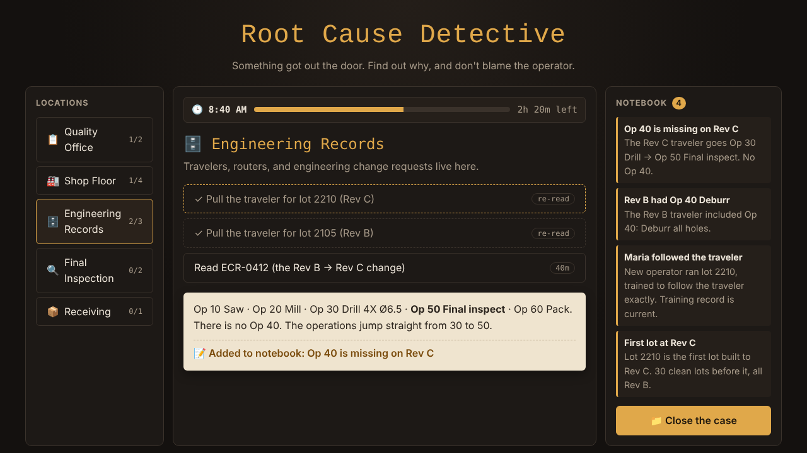

# Root Cause Detective

**[▶ Play it in your browser](https://slee9817.github.io/root-cause-detective/)**

A detective game about manufacturing quality. A customer rejects a lot of parts; you're the
quality engineer with a few hours before the customer call. Visit locations around the
plant, interview people, and pull records. Then sort your evidence onto a fishbone diagram
and name the root cause.

The catch: the game grades **how good your root cause is**.

- Blaming a person ("operator error", "the inspector missed it", "the supplier messed up")
  scores zero. In every case, the person everyone wants to blame did exactly what the
  system told them to.
- You have to find both the **occurrence** root cause (why it happened) and the
  **escape point** (why your own inspection didn't catch it), the two halves of an 8D.
- A right answer without the evidence to back it up only gets partial credit.
- Every action costs time, and there isn't enough to check everything. Good
  investigations start with "what changed?"

## Cases

| Case | The problem |
|---|---|
| **#1 The Burr Lot** | 40 aerospace brackets rejected for burrs on every hole |
| **#2 The Mirror Image** | 12 right-hand parts shipped in a left-hand box |
| **#3 The Trusted Gage** | Our records say every shaft is in tolerance; the customer's CMM disagrees |
| **#4 The Soft Batch** | Heat-treated pins come back 10 HRC too soft |

All cases are fictional.

## How it works

| File | What it does |
|---|---|
| `cases.js` | The cases, as plain data: briefings, locations, actions, clues, fishbone categories, answer options, and scoring |
| `game.js` | The engine: screens, the investigation clock, the notebook, the fishbone, scoring, and saved best grades. It knows nothing about any specific case. |
| `index.html`, `style.css` | The page |

Adding a case means adding an entry to `cases.js`, with no engine changes. Plain HTML, CSS,
and JavaScript: no frameworks, no build step, no server.

## Running it locally

Open `index.html` in any browser.
